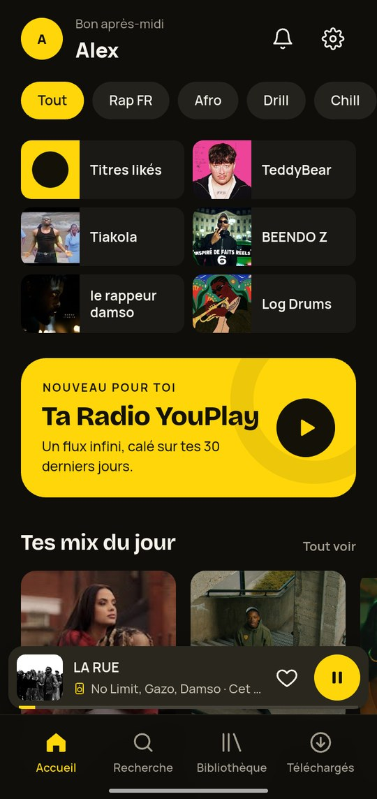
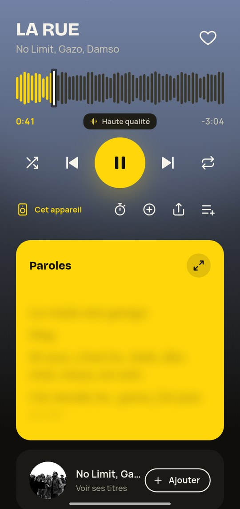
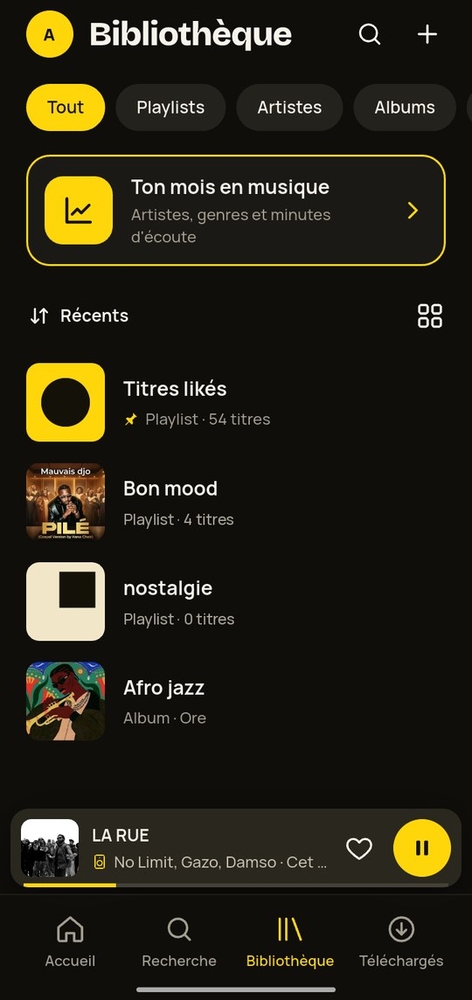
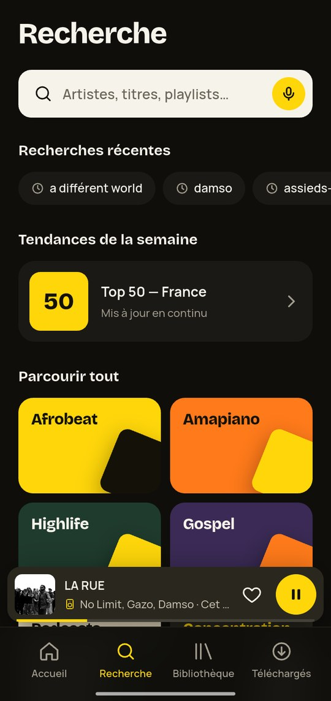

# YouPlay

[English](README.md) · [Site officiel](https://cianusdev.github.io/youplay/) · **[⬇ Télécharger la dernière version](https://github.com/CianusDev/youplay/releases/latest)**

<p align="center">
  
  
  
  
  
</p>

Lecteur de musique Android open source, façon Spotify, sans pub ni limite de sauts. Le catalogue vient de YouTube, via [NewPipeExtractor](https://github.com/TeamNewPipe/NewPipeExtractor).

> YouPlay n'est ni affilié à YouTube ni à Google, ni approuvé par eux. L'app peut cesser de fonctionner quand YouTube change son fonctionnement interne : il faut alors mettre à jour NewPipeExtractor. Utilise-la à tes risques et respecte les droits des artistes.

## Fonctionnalités

- **Accueil :** filtres Tout, Rap FR, Afro, Drill et Chill. On y trouve aussi les accès rapides vers tes artistes, des Daily Mix, les Nouveautés et les artistes écoutés récemment.
- **Recherche :** titres, artistes et albums YouTube, avec un historique des recherches récentes.
- **Lecteur plein écran :**
  - Contrôles : aléatoire, répétition, file d'attente, barre de progression en forme d'onde, glisser pour changer de titre.
  - Fond coloré selon la pochette, qui change en fondu à chaque titre.
- **Paroles synchronisées :** fournies par [LRCLIB](https://lrclib.net). Elles défilent toutes seules, la ligne en cours est animée, et taper sur une ligne fait sauter le son à ce passage.
- **Radio :** un flux infini à partir du dernier titre écouté.
- **Lecture en arrière-plan :** contrôles dans la notification et sur l'écran de verrouillage.
- **Téléchargements hors ligne :**
  - Les fichiers vont dans `Music/YouPlay`, avec des noms lisibles comme `Artiste - Titre.m4a`.
  - Un mode hors ligne ne lit que les titres téléchargés.
  - Le téléchargement intelligent récupère automatiquement les titres likés.
- **Bibliothèque :** titres likés, playlists perso, artistes et albums ajoutés, et les statistiques « Ton mois en musique ».
- **Reprise de lecture :** au redémarrage, l'app retrouve le dernier titre, sa position et la file d'attente.
- **Minuteur de sommeil :** de 5 à 60 minutes, ou à la fin du titre en cours.
- **Sauvegarde :** exporte ta bibliothèque dans un fichier et restaure-la sur un autre téléphone.
- **Mises à jour :** chaque push sur `main` publie une release. Si tu l'acceptes au premier lancement, l'app vérifie au démarrage et propose de l'installer.

Toutes les données restent sur le téléphone, sans compte ni serveur.

## Stack

| Rôle | Choix |
|---|---|
| UI | Flutter, `google_fonts` (Bricolage Grotesque, Manrope), `flutter_svg` |
| État | `flutter_riverpod` |
| Navigation | `go_router`, avec 4 onglets en `StatefulShellRoute` et le lecteur en modal |
| Audio | `just_audio`, avec `just_audio_background` pour la lecture en arrière-plan |
| Source | NewPipeExtractor v0.26.5 en Kotlin, via le canal `sika/newpipe` |
| Paroles | API LRCLIB |
| Stockage | `shared_preferences` pour les données, fichiers dans `Music/YouPlay` |

## Structure

```
lib/
  main.dart                 initialisation : audio en arrière-plan, préférences
  router.dart               onglets + route /player
  theme/sika_tokens.dart    couleurs, typo, rayons (design system)
  data/
    youtube_source.dart     canal NewPipe + source audio paresseuse (URL résolue à la lecture)
    lyrics_api.dart         recherche et parsing des paroles (LRC)
    media_storage.dart      dossier Music/YouPlay, permissions, médiathèque
    models.dart             Track, Artist, Playlist, CollectionRef
  state/
    player_controller.dart  file d'attente, radio, sauvegarde de session
    download_manager.dart   téléchargements hors ligne
    library_store.dart      likes, playlists, historique
    providers.dart          providers Riverpod
  ui/
    components/             CoverArt, MiniPlayer, BottomNav, WaveformSeekBar…
    screens/                accueil, recherche, bibliothèque, collection, lecteur, téléchargés
android/app/src/main/kotlin/…/NewPipeBridge.kt   recherche, flux audio, titres liés
sika-handoff/               maquette d'origine (specs, HTML, captures)
.github/workflows/release.yml  build + release GitHub à chaque push sur main
```

## Lancer le projet

Il faut Flutter 3.44 ou plus récent, le SDK Android, et un téléphone Android. YouTube ne fonctionne pas dans la version web.

```bash
flutter pub get
flutter run                      # appareil branché
```

Pour compiler la release et la copier directement sur le téléphone branché en USB :

```bash
./build.sh               # build release + copie dans Téléchargements/YouPlay.apk
./build.sh --skip-build  # recopie le dernier APK compilé
```

Le script choisit l'APK adapté au processeur du téléphone. On l'installe ensuite depuis le gestionnaire de fichiers, car MIUI bloque souvent `adb install`.

Pour compiler l'APK release à la main, environ 22 Mo :

```bash
flutter build apk --release --split-per-abi
# build/app/outputs/flutter-apk/app-arm64-v8a-release.apk
```

## Tests

```bash
flutter analyze
flutter test
```

## Limites connues

- **Android uniquement :** NewPipeExtractor est une librairie Java.
- **Recherche :** la recherche YouTube Music de l'extracteur ne renvoie rien actuellement. L'app cherche donc parmi les vidéos YouTube et nettoie leurs titres.
- **Paroles :** sur un clip avec une intro, elles peuvent être légèrement décalées, car le minutage vient de la version audio.

## Licence

YouPlay est distribué sous licence [GNU GPL v3](LICENSE), comme [NewPipeExtractor](https://github.com/TeamNewPipe/NewPipeExtractor) sur lequel il s'appuie : tu peux utiliser, modifier et redistribuer l'app, à condition de publier tes modifications sous la même licence.
