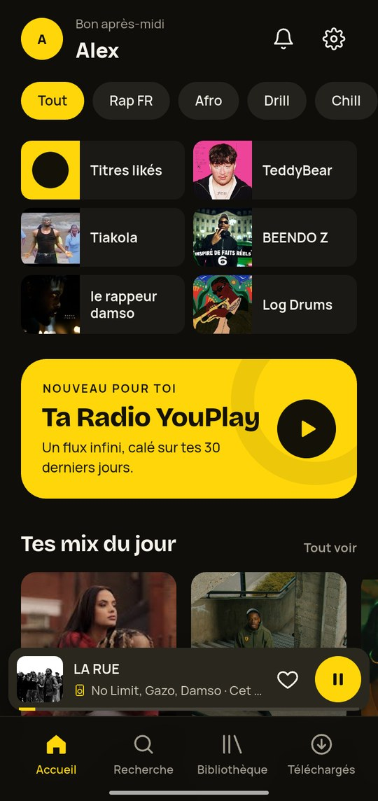
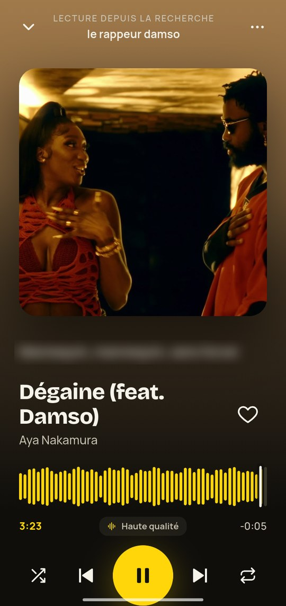
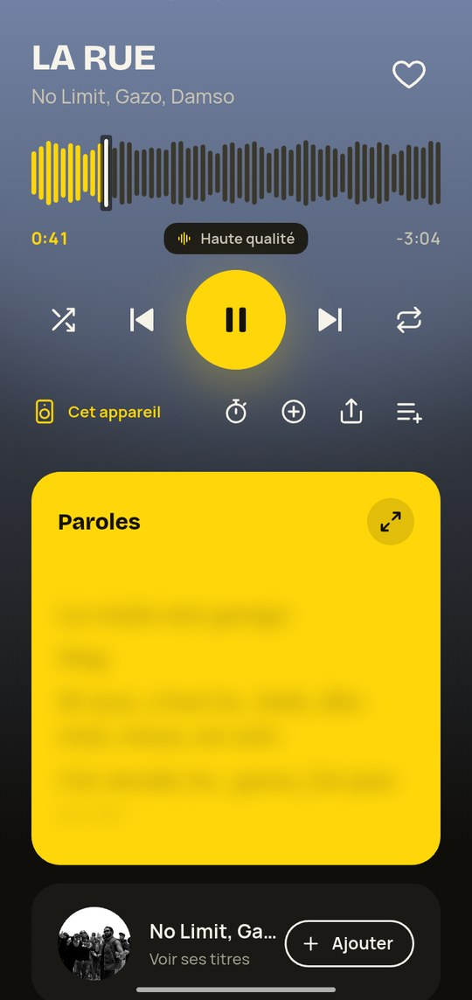
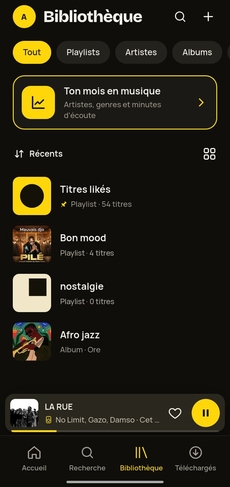
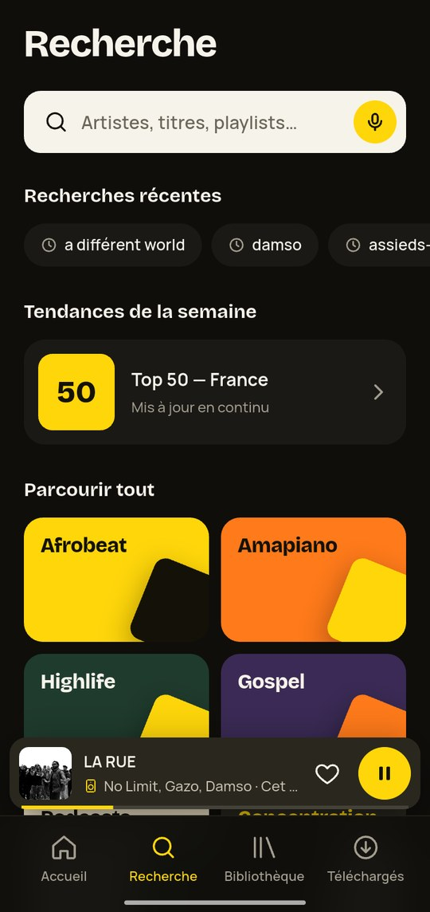

<div align="center">


# YouPlay

**An open-source Android music player built on YouTube.**<br>
No ads, no skip limits, background & offline playback, synced lyrics.

[](https://github.com/CianusDev/youplay/releases/latest)
[](LICENSE)


### [⬇ Download the latest APK](https://github.com/CianusDev/youplay/releases/latest)

[Website](https://cianusdev.github.io/youplay/) · [Français](README.fr.md)

</div>

<p align="center">
  
  
  
  
  
</p>

## Features

- **Free streaming from YouTube**: no ads, no account, no skip limits.
- **A player made for music**: waveform seek bar, shuffle, repeat, queue, swipe to change track, background color taken from the artwork.
- **Synced lyrics** from [LRCLIB](https://lrclib.net): they scroll by themselves, tap a line to jump to it, share lyrics as an image. The current line also shows under the artwork.
- **Background playback** with notification and lock-screen controls, resistant to aggressive battery savers (MIUI, HyperOS).
- **Offline downloads**: readable files in `Music/YouPlay` (`Artist - Title.m4a`), one folder per playlist, visible to any other player.
- **Library**: liked songs, your own playlists, saved artists and albums, monthly listening stats.
- **Sleep timer**: 5 to 60 minutes, or at the end of the current song.
- **Endless radio** from the last song you played.
- **Backup**: export your library to a file and restore it on another phone.
- **Updates**: if you allow it on first launch, new versions are offered inside the app.
- **English and French**: follows your phone's language, or pick one in Settings.
- **Private**: no account, no server, everything stays on your phone.

## Install

1. Download [**YouPlay.apk**](https://github.com/CianusDev/youplay/releases/latest/download/YouPlay.apk) on your phone (older 32-bit phones: `app-armeabi-v7a-release.apk` from the [latest release](https://github.com/CianusDev/youplay/releases/latest)).
2. Open it and allow your browser or file manager to install apps.
3. That's it: new versions are offered in the app if you allow it (Settings › Check automatically, or Updates › Check).

You can also track releases with [Obtainium](https://github.com/ImranR98/Obtainium) using this repository's URL.

## Build from source

Requires Flutter 3.44+, the Android SDK and Java 17.

```bash
flutter pub get
flutter run                                      # connected device
flutter build apk --release --split-per-abi      # build/app/outputs/flutter-apk/
```

```bash
flutter analyze
flutter test
```

Every push to `main` builds a signed APK and publishes it as a GitHub release ([workflow](.github/workflows/release.yml)); the app compares its version code with the latest release.

## Tech stack

| Role | Choice |
|---|---|
| UI | Flutter, `google_fonts`, `flutter_svg` |
| State | `flutter_riverpod` |
| Navigation | `go_router` |
| Audio | `just_audio`, `just_audio_background`, `audio_session` |
| Source | [NewPipeExtractor](https://github.com/TeamNewPipe/NewPipeExtractor) (Kotlin bridge) |
| Lyrics | [LRCLIB](https://lrclib.net) API |

## Contributing

Issues and pull requests are welcome. The app is available in English and French; to add a language, copy `lib/l10n/app_en.arb` to `app_<code>.arb`, translate it and open a pull request. For a big change, open an issue first so we can discuss it. Please run `flutter analyze` and `flutter test` before submitting.

## Disclaimer

YouPlay is not affiliated with, endorsed by, or connected to YouTube or Google. It may stop working when YouTube changes its internals, until NewPipeExtractor is updated. Use it at your own risk and respect the rights of artists.

## License

YouPlay is free software released under the [GNU GPL v3](LICENSE), like [NewPipeExtractor](https://github.com/TeamNewPipe/NewPipeExtractor) which it builds on.
